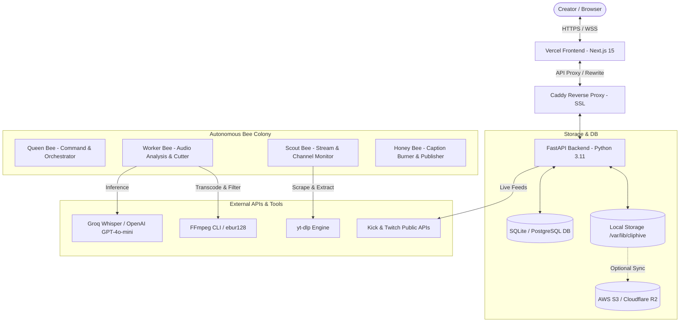
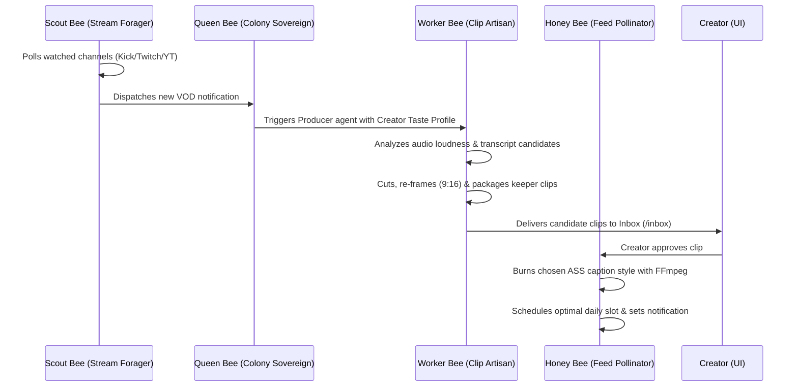

# ClipHive Systems Architecture & Technical Reference

ClipHive is an autonomous, AI-powered clipping and caption studio that transforms livestreams into polished, captioned vertical short-form videos (TikTok, YouTube Shorts, Instagram Reels).

---

## 1. High-Level Architectural Topology

ClipHive separates the application into a reactive Next.js 15 frontend, a high-performance FastAPI asynchronous backend, and background workers for audio/video media processing.



### Core Technologies
- **Frontend**: Next.js 15 (App Router), React 19, Tailwind CSS, Lucide-style Iconography, custom role-token Design System (`check-design.mjs`), HTML5 Media Sync.
- **Backend**: FastAPI, SQLAlchemy 2.0 ORM, Pydantic V2, Starlette Async HTTP.
- **Audio/Video Processing**: FFmpeg (ebur128 loudness filtering, scale/crop filters, ASS subtitle burning), `yt-dlp` (video streaming & channel inspection).
- **AI & Speech**: Groq Cloud (`whisper-large-v3-turbo` for rapid word-level transcription), OpenAI API (`gpt-4.1-mini` for autonomous agent tool loops), offline rule-based fallbacks.
- **Deployment**: AWS EC2 (t3.small, Ubuntu 24.04), Caddy (automated Let's Encrypt SSL), Vercel (Hobby edge distribution), Systemd timers for zero-downtime auto-updates.

---

## 2. Autonomous Agent Swarm (The Bees)

The platform models content curation as a collaborative colony of bees (`backend/app/services/agents/`). Every action is recorded as a structured event and streamed live to the UI.



### 1. Queen Bee (Colony Sovereign — Command & Orchestrator)
- **Role**: High-level planner and taste coordinator (`command.py`, `learning.py`).
- **Implementation**:
  - Exposes an interactive natural language command bar (e.g., *"Make 3 funny clips under 30s for Shorts"*).
  - Uses OpenAI / Groq tool-calling runtime (`runtime.py`) to break commands into plans, query streamer catalogs, and invoke producer jobs.
  - Maintains the **Creator Taste Profile**: passively learns from creator behavior (rejection reasons, title edits, font style adjustments) to refine future clip selection criteria.

### 2. Scout Bee (Stream Forager — Channel Monitor)
- **Role**: Monitors streamer channels for new livestreams and VODs (`scout.py`, `monitor.py`).
- **Implementation**:
  - Uses `yt-dlp` channel inspection to poll Kick, Twitch, and YouTube channels without downloading raw video data.
  - Detects live streams vs. published VODs and triggers the ingest pipeline upon completion.
  - Features intelligent tab-fallback (switches from `streams` to `videos` when a channel lacks dedicated livestream archives) and bot-detection detection.

### 3. Worker Bee (Clip Artisan — Producer Agent)
- **Role**: Discovers viral candidate moments, validates them via speech transcripts, and cuts the video (`producer.py`, `detector.py`, `cutter.py`).
- **Implementation**:
  - **Audio Energy Scanning**: Runs FFmpeg's `ebur128` filter to compute loudness (LUFS) across the raw audio track, flagging peaks where chat/streamer excitement is high.
  - **Candidate Over-sampling**: Generates $\approx 3\times$ the requested target moments.
  - **Speech Verification**: Transcribes the candidate windows with Whisper and uses LLM tool-calling to reject weak candidates (low context, repetitive speech, abrupt silence) with concrete reasons.
  - **Lossless / Re-encoded Cutting**: Extracts precise start/end timestamps and applies vertical cropping (9:16 aspect ratio).

### 4. Honey Bee (Feed Pollinator — Publisher Agent)
- **Role**: Manages the approval inbox, burns typography, and schedules distribution (`publisher.py`).
- **Implementation**:
  - Waits in `/inbox` for creator approval or rejection feedback.
  - Upon approval, generates styled ASS subtitle scripts and invokes the FFmpeg subtitle burner.
  - Calculates optimal daily posting windows per platform (e.g., TikTok peak 18:00–21:00) and queues reminders in `/hub`.

---

## 3. Ingest & Video Processing Pipeline

The ingest pipeline (`backend/app/services/ingest/`) handles the download, validation, and preparation of stream media:

```
Stream URL / Upload ──> Downloader (yt-dlp) ──> Source File (.mp4)
                              │
             ┌────────────────┴────────────────┐
             ▼                                 ▼
   Audio Loudness (ebur128)          Audio Extraction (.m4a)
             │                                 │
             ▼                                 ▼
   Moment Peaks Detection            Groq Whisper Transcription
             │                                 │
             └────────────────┬────────────────┘
                              ▼
                 Worker Bee Producer Engine
```

- **Downloader (`downloader.py`)**: Rotates `yt-dlp` player clients (`web_embedded`, `mweb`, `default`) and supports Netscape cookie injection to bypass rate-limiting. Blocks live streams and full playlists with user-friendly error messages.
- **Audio Detection (`detector.py`)**: Runs two-pass loudness detection. The first pass measures the integrated loudness baseline; the second detects sudden momentary spikes exceeding dynamic threshold decibels.
- **Transcription Service (`whisper_service.py`)**: Extracts the audio track with FFmpeg (`-vn -acodec copy` or AAC re-encode) and sends it to Groq's high-speed Whisper Large V3 Turbo API, receiving JSON with exact word-level start and end timestamps.

---

## 4. Caption & Typography Engine

ClipHive features a typography engine that turns word-level transcripts into social-media style subtitles (`backend/app/services/caption/`):

- **ASS Subtitle Generation (`ass_generator.py`)**:
  - Compiles word-level timestamps into Advanced SubStation Alpha (`.ass`) format.
  - Implements word-by-word karaoke highlighting (`{\k...}` tags), active-word bounce scale effects (`{\fscx115\fscy115}`), and color overrides.
  - Automatically wraps phrases to 2–4 words per line for high readability on mobile screens.
- **Font Inspector & Asset Caching (`fonts.py`, `font_inspector.py`)**:
  - Ships with 14 preset styles (e.g., *Punch*, *Neon*, *Minimal*, *Retro*, *Impact*).
  - Inspects user-uploaded `.ttf` / `.otf` files to extract true PostScript font names via `fontTools`.
  - Caches fonts locally and exposes them through `/editor-fonts` for the frontend editor canvas.
- **Subtitle Burner (`burner.py`)**:
  - Executes FFmpeg using the `subtitles` video filter (`subtitles='file.ass':fontsdir='...'`).
  - Employs hardware-assisted H.264 encoding with `-movflags +faststart` for instant web streaming.

---

## 5. Interactive Video Editor & Studio

Located in `frontend/app/editor/` and `frontend/components/editor/`:

```
┌────────────────────────────────────────────────────────┐
│ [ Header / Export ]                     [ Aspect 9:16] │
├────────────────────────────────┬───────────────────────┤
│                                │ [AI Editor Assistant] │
│      Video Preview Player      │ > Make the intro fast │
│   (HTML5 Canvas & Overlays)    ├───────────────────────┤
│                                │ [Inspector Panel]     │
│                                │ - Captions & Fonts    │
│                                │ - SFX & Music Volume  │
├────────────────────────────────┴───────────────────────┤
│ [Playhead: 00:14.2] [Split] [Delete]                   │
│ Track 1 (Video): [========== Clip 1 ==========]        │
│ Track 2 (Audio): [Whoosh.mp3]       [Boom.wav]         │
│ Track 3 (Text) : [  "INSANE PLAY!"  ]                  │
└────────────────────────────────────────────────────────┘
```

- **State Management (`frontend/lib/editor.ts`)**: Pure TypeScript state container managing non-destructive timeline operations: split, trim, multi-track audio sound effects (SFX), text overlays, and stickers.
- **AI Editor Assistant (`assistant.py`)**: Translates creator requests ("cut the first 3 seconds", "add a riser sound effect before the climax") into deterministic timeline mutations.
- **Server-Side Composition (`compose.py`, `render.py`)**: Renders editor timelines into standalone MP4 files using FFmpeg complex filtergraphs (`filter_complex`), blending video tracks, audio overlays, and typography layers.

---

## 6. Trend Intelligence & Clip Radar

Located in `backend/app/services/trends/` and `frontend/components/trends/`:

- **Clip Radar (`radar.py`)**:
  - Scrapes active trending streams and top clip leaderboards directly from Kick and Twitch.
  - Aggregates topics, categories, clip view counts, and duration distributions.
  - Identifies patterns: title capitalization ratios, emoji usage frequency, and optimal clip lengths (<60s).
- **Personalized Suggestion Engine (`suggest.py`)**:
  - Cross-references the global radar with the creator's saved channels, recently approved clips, and topic affinities.
  - Produces prioritized recommendations: *Clip Topic*, *Watch Creator*, *Format Recommendation*, and *Title/Hook Suggestions*.
- **Social Search (`social_search.py`)**:
  - Scrapes public YouTube Shorts hashtag feeds (`youtube.com/hashtag/<topic>/shorts`).
  - Ranks hashtags by real view counts, eliminates spam tags, and generates viral metadata for export.

---

## 7. Storage, Security & DevOps Infrastructure

### Storage Architecture (`object_store.py`)
- **Tier 1 (Local Disk)**: High-speed NVMe/SSD storage under `/var/lib/cliphive/storage` for active jobs, raw downloads, and rendered clips.
- **Tier 2 (Cloud Object Store)**: S3-compatible backend (AWS S3 or Cloudflare R2). If configured, media files are asynchronously synchronized to S3.
- **Cache Eviction**: A background task periodically evicts old raw video files from local disk once synced, redirecting web requests to signed S3 URLs via HTTP 307.

### Authentication & Authorization (`auth.py`, `deps.py`)
- Stateless JWT authentication delivered via `Authorization: Bearer <token>`.
- Client-side token storage in `localStorage` with mirrored `ch_session` cookies for Next.js SSR middleware route protection.
- Dual password support: Argon2 / Bcrypt hashing plus Google OAuth 2.0 Identity verification.

### Production Deployment & Zero-Downtime Pipeline (`docs/DEPLOYMENT.md`)
- **Frontend**: Continuous deployment on **Vercel** connected to GitHub `main`.
- **Backend**: **AWS EC2** (Ubuntu 24.04) running behind **Caddy** web server with automatic HTTPS.
- **Auto-Update Engine (`deploy/oracle/update.sh`)**:
  - EC2 runs a systemd timer (`cliphive-update.timer`) every 3 minutes.
  - Automatically pulls new commits, creates a timestamped database backup, runs database migrations, and **executes the entire pytest test suite in a sandbox**.
  - If tests fail, the deployment is blocked and the existing server continues uninterrupted.
  - If tests pass, systemd restarts the service and verifies `/health`. If `/health` fails, it rolls back automatically to the previous commit.
